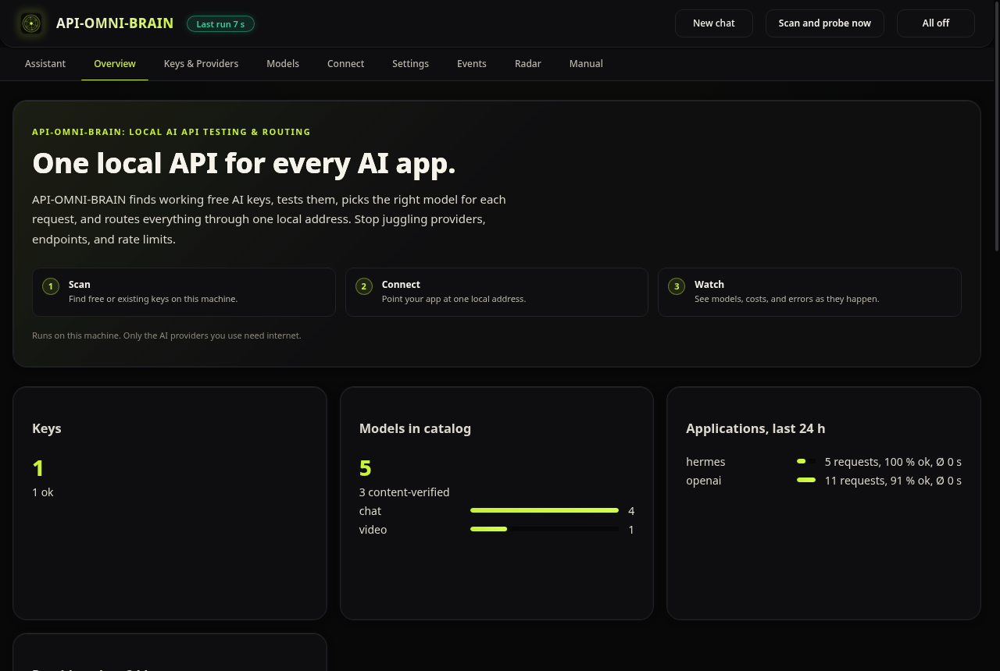
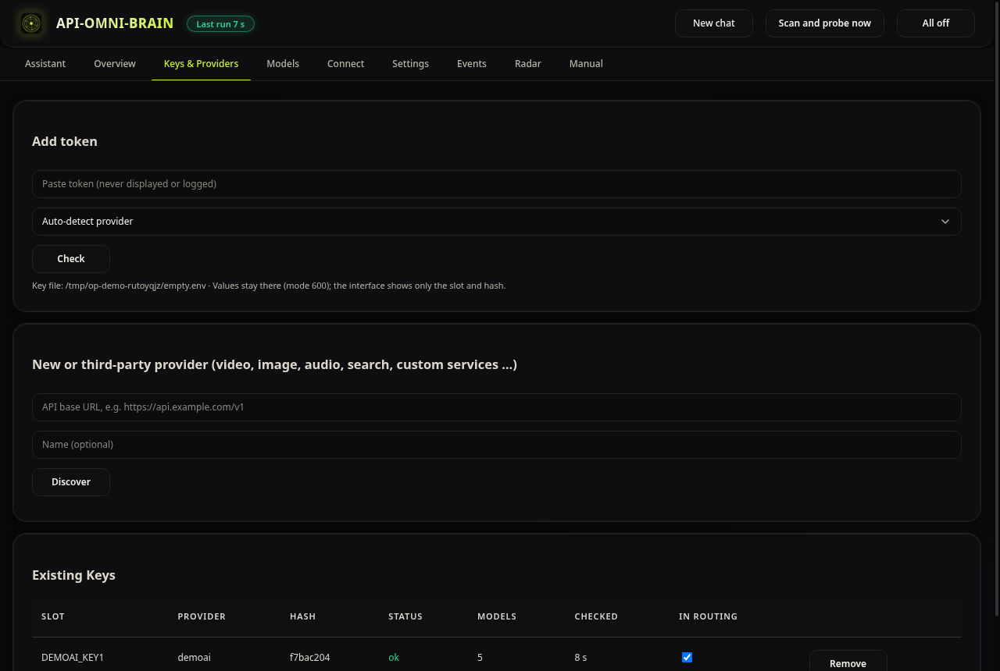
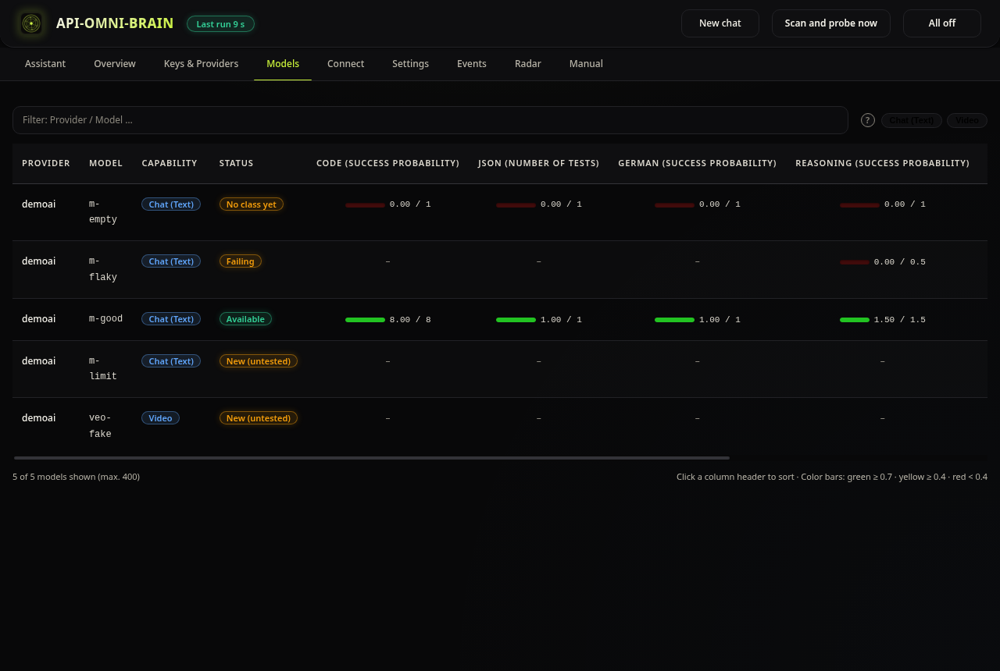
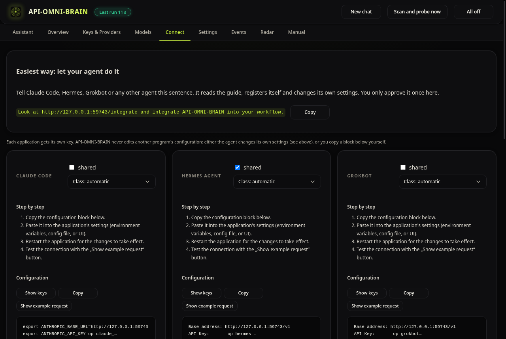
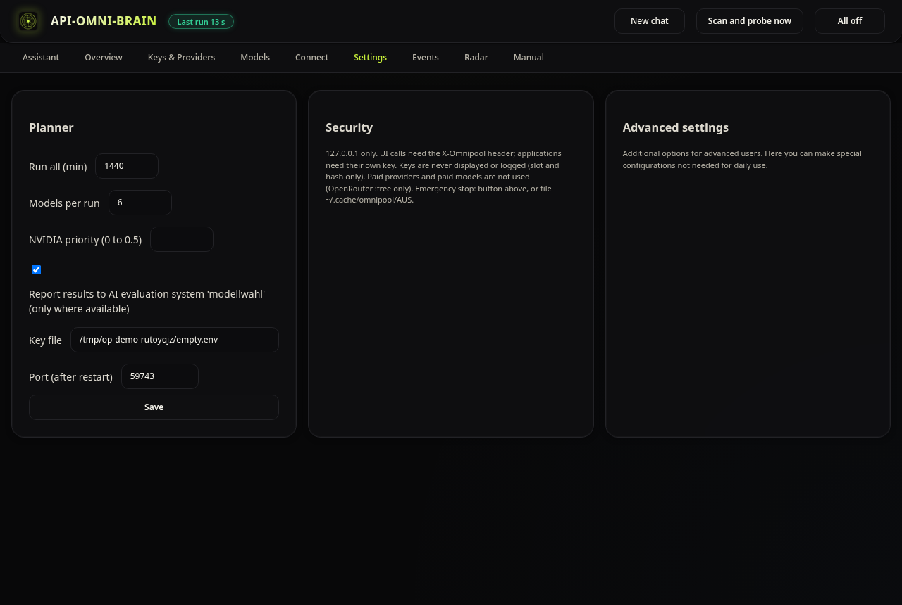
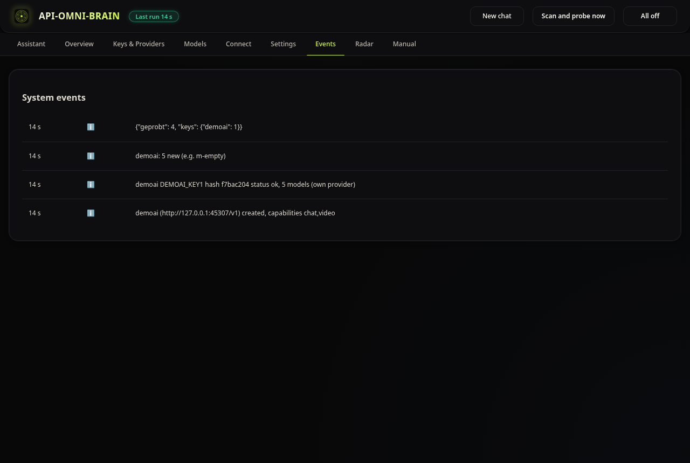
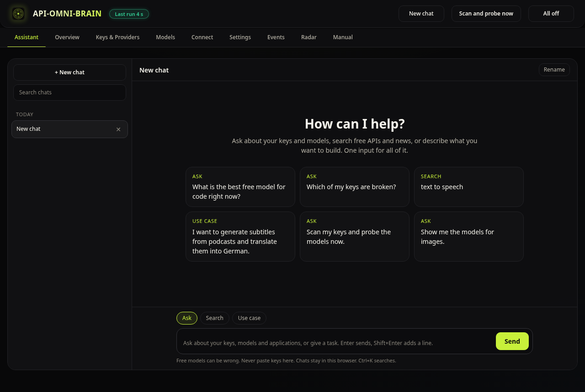
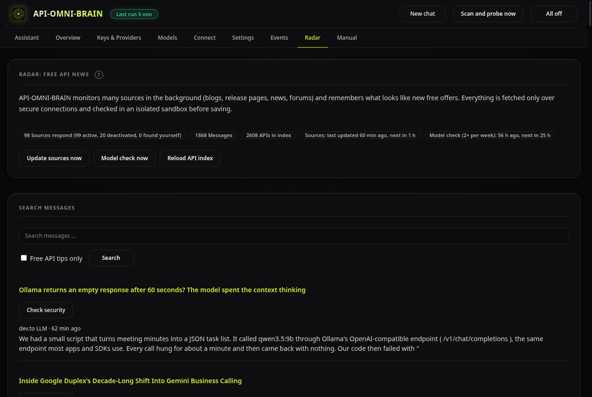

# Manual

API-OMNI-BRAIN is a local application: a daemon on 127.0.0.1:8799 plus a web interface that opens in its own window. It manages your free-tier API keys on your machine, probes models, ranks them and routes requests through a local OpenAI- and Anthropic-compatible proxy. No key is shipped with the app; a key leaves your machine only toward the provider it belongs to.

## Overview

The first screen: counts of keys and catalogued models, per-application and per-provider usage of the last 24 hours, the status of the internal 'organs' (scanner, probes, router, ...), the best model per class and models that are currently resting after errors. The header shows the run state and has two buttons: scan now, and the emergency stop.

1. Read the key and model counts and their status
2. See which applications and providers used the proxy in the last 24 hours
3. Look at the organ list to see when each part last ran
4. Use 'Scan and probe now' to start a scan, or 'All off' to stop routing

**What it can do**

- Show key and model counts and the best model per class
- Show usage per application and provider over 24 hours
- Show which models are resting and why
- Start a scan on demand and switch everything off with one click

**What it cannot do - and must not**

- It does not start or stop the operating-system service (use systemctl --user)
- It does not add, remove or test keys here (that is the Keys & Providers tab)
- It does not change settings here

## Keys & Providers

Paste a token; the app recognises its format, checks it live, and saves it only after you confirm. Unknown OpenAI-compatible providers can be added by URL and token after a safety gate.

1. Paste an API token into the input field
2. Wait for automatic format recognition and live validity check
3. Confirm to save the key locally
4. Add a custom provider by entering its base URL and token
5. Pass the safety gate before the key is sent to the new provider

**What it can do**

- Recognise the token format and check it live before saving
- Save keys in a local key file with owner-only permissions
- Add a custom OpenAI-compatible provider by address after a safety gate

**What it cannot do - and must not**

- It does not create accounts or obtain keys for you
- It does not bypass the safety gate for unknown providers
- It never shows a key in clear text (slot and short hash only)
- It sends a key only to the provider it belongs to

## Models

The catalogue lists every model from working providers, grouped into classes (code, JSON, German, reasoning, long context, tool calling) with probe scores and status.

1. Open the tab and type part of a provider/model name into the filter
2. Filter by capability
3. Sort by provider, model, capability or status
4. Read the probe results (code, JSON, German, reasoning, long text, tools) per model

**What it can do**

- Display all models from working providers with their classes
- Show probe results for code, JSON, German, reasoning, long context, tool calling
- Sort and filter the model list
- Indicate model status (valid, rate-limited, etc.)

**What it cannot do - and must not**

- It does not run a probe on one chosen model on demand (probes are planned by the scheduler or 'Scan and probe now')
- It does not edit classes or probe definitions
- Scores are measurements of a past run, not a guarantee of current quality
- It does not list models from providers you have no working key for

## Connect

Get the local proxy URL and per-app keys to connect Claude Code, Hermes, Crush, Aider, or any OpenAI/Anthropic-compatible client. Copy buttons and an on/off switch are provided.

1. Easiest: tell your agent "Look at http://127.0.0.1:8799/integrate and integrate API-OMNI-BRAIN into your workflow". It registers itself and you approve it once on this tab
2. Copy the local proxy address shown on the tab
3. Create or copy the per-application key (one per application, switchable)
4. Paste address and key into your client (Claude Code, Aider, any OpenAI- or Anthropic-compatible client)
5. Use the virtual model 'omnipool-auto' (or -code, -json, -de, -reason, -long, -tool) for automatic routing

**What it can do**

- Let an agent integrate itself: /integrate guide, self-registration with one-click approval, offer of what it can take over, and an MCP server (api-omni-brain --mcp)
- Show address and a separate key for each application
- Show ready-made setup snippets and an example request (display only, not sent)
- Switch single applications on or off and add more applications
- Pass through non-chat calls (image, audio, embeddings, search) via /x/<provider>/...

**What it cannot do - and must not**

- It does not configure your client itself: the agent does that after your approval, otherwise the tab only shows instructions
- Claude Code accepts its MCP server (connection check passes), but real conversations with Claude Code, Hermes and Grokbot have not been tested live
- It does not support clients that need other API styles than OpenAI or Anthropic

## Settings

Planner and routing options: how often the planner runs, how many models it probes per run, a provider priority bonus, optional reporting to the author's internal evaluation system, the key file location and the port (applies after a restart).

1. Set the run interval in minutes and the number of models per run
2. Optionally change the NVIDIA priority (0 to 0.5)
3. Leave the 'modellwahl' reporting off unless you run that system (it is only available on the author's machines)
4. Change the key file path or the port if needed, then press Save

**What it can do**

- Change planner interval and models per run
- Change a provider priority bonus
- Change the key file path and the port (after restart)
- Read the security notes and the emergency-stop file name

**What it cannot do - and must not**

- It does not edit the safety scanner or quarantine rules (those are fixed in code)
- It does not reset keys or probe data
- It does not change what the router is allowed to spend: paid providers and paid models are never used

## Events

A list of recent system events (information and warnings), newest first, with their age. The list is read-only and refreshes with the next planner run.

1. Open the tab
2. Read the entries, newest first; the icon shows information or warning

**What it can do**

- Show recent system events with age and level icon

**What it cannot do - and must not**

- It does not filter, search or export events
- It does not clear the log
- It is not an audit log for compliance purposes

## Assistant

The first page. A normal AI chat with sessions, and every kind of search in the same input: ask questions, search free APIs, news and your own models, or describe a use case. The chat answers with a free model from your own pool (weaker than a frontier model, and it says so) and gets only a short live summary, never a key.

1. The Assistant opens first; press New chat (header or left column) for a fresh session, earlier sessions stay in the left column
2. Pick Ask, Search or Use case above the input (or type /search words, /usecase text), then press Enter
3. Ask: for example 'What is the best model for code?' or 'Scan now'. Search: for example 'text to speech' returns free APIs with a safety verdict, news and matching models you already have. Use case: describe what you want to build and get suitable APIs
4. If the assistant proposes an action (scan, emergency stop, open a tab), press the button it shows. Ctrl+K jumps into Search from anywhere

**What it can do**

- Answer in German or English about the live state: best model per class, models per capability, applications, keys (counts only)
- Search the free-API index, the collected news and your own models in one go, with a safety verdict per API
- Propose a scan, the emergency stop (and undoing it) or opening a tab; you press the button, nothing changes without your click
- Keep several chat sessions, rename, search and delete them; stop an answer while it is running, copy answers and code blocks, try an answer again
- Refuse text that looks like an API key before it is sent or saved

**What it cannot do - and must not**

- It cannot add, show or change keys; use Keys & Providers
- It does not change settings, applications or data on its own: state changes are only proposals
- It can be wrong: it is a free model and sees only a summary; check important answers in the matching tab
- Chats are stored only in this browser (this computer), not on a server; clearing the browser data deletes them
- Cannot search the live web: search covers the local API index, the collected news and your models; safety verdicts are signals, not proof

## Radar

Aggregates ~110 news feeds and 10 Hacker News searches every 2 hours, indexes ~2600 free-API entries with full-text search, re-checks models twice weekly, and matches use cases. Quarantined files are scanned, overwritten with zeros, and deleted with a popup; there is no release button.

1. View latest news and Hacker News items
2. Search the free-API index with full-text search
3. Read safety verdicts for URLs (TLS, domain age, shorteners, punycode, risky TLDs)
4. See quarantined items with explanation

**What it can do**

- Display aggregated news from ~110 feeds and HN
- Search ~2600 free-API entries with full-text search
- Show safety verdicts for URLs
- Explain quarantined items: scanned, found unsafe, overwritten and deleted

**What it cannot do - and must not**

- Cannot fetch from Reddit (blocked on purpose)
- Cannot release or recover quarantined files
- Cannot guarantee all feeds are alive (95 of 129 alive at first run)
- Cannot verify safety beyond signatures and heuristics

## What this app cannot do - and does not want to

- It is not an antivirus: the scanner uses signatures and heuristics; 'nothing found' is not 'proven harmless'.
- It does not create accounts, buy anything, handle payments, trade, or move money.
- It never writes into other programs' configuration itself (an agent changes its own configuration, only after you asked it to and approved it here).
- It does not bypass rate limits, quotas, terms of service, CAPTCHAs, or paywalls.
- It does not farm or share keys.
- It does not crawl behind logins.
- It cannot make a free API reliable: free tiers change, vanish, throttle; rankings are measurements of today.
- It does not guarantee privacy at the provider: your prompts go to the provider you route to; their policies apply.
- Search is only as good as the index; the judge model is coarse; the vision judge used for UI scoring is noisy (+-0.5 on a 10 scale).
- Not tested on other distributions or Python versions than the listed ones (Linux x86_64 glibc >= 2.38, Python 3.12).

> You are responsible for obtaining and using API keys in accordance with each provider's terms of service. Your prompts are sent to the providers you route to; their privacy policies apply. Free tiers may change or vanish without notice; the app's rankings reflect measurements at the time of the scan. The app has only been tested on Linux x86_64 with glibc >= 2.38 and Python 3.12; other environments are unsupported.
